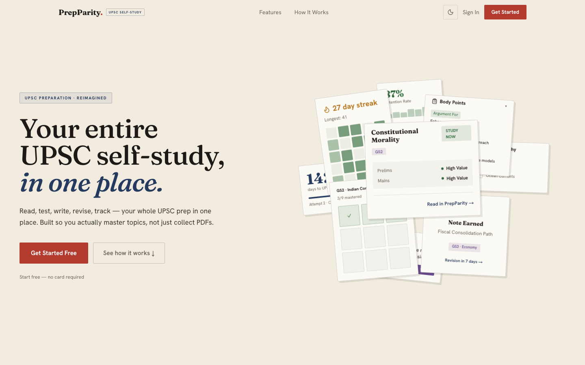
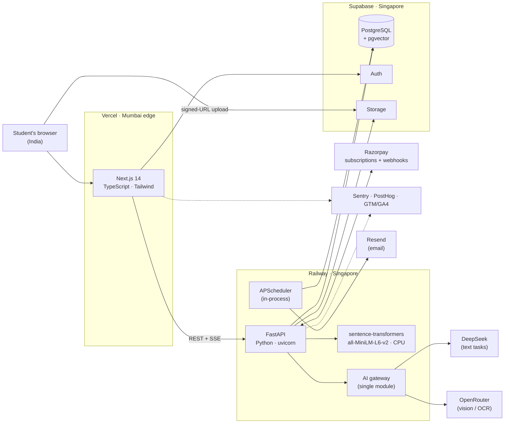

  

<h1 align="center">PrepParity</h1>

  A self-study platform for India's civil services exam (UPSC), built and run solo. 
  <a href="https://prepparity.com"><b>prepparity.com</b></a> · in production since December 2025

<!-- App screenshots / walkthrough video go below the landing image once captured. -->

  

> **About this repository.** The product's source code is private. This repo documents how the system is built: the architecture, the stack, and the production problems I diagnosed and fixed. Every number here was counted from the private repository, and the counting method is listed under [the numbers](#the-numbers).

## What it does

UPSC aspirants spend years reading, and most of them can't tell which topics they could actually answer in the exam. PrepParity takes whatever they study (a PDF, a pasted article, a photo of handwritten notes) and turns it into practice:

1. It scores the material for exam relevance against the syllabus and years of past papers, and labels it *Study now*, *Study if time*, or *Skip*.
2. It extracts the key points into a fixed structure (introduction, body, conclusion, data, reports, court judgments and more). Every extracted point is tied to the paragraph it came from.
3. It finds the real past exam questions on that exact topic, makes the student commit to an answer, then has them write a structured Mains answer.
4. A topic only counts as covered once the student has done all of that. Spaced-repetition revision, a syllabus coverage map, timed mock tests and a 30-day study plan sit on top.

The AI works on the student's own material. It scores, extracts, transcribes, questions and critiques. It doesn't write their answers.

## The numbers

| | |
|---|---|
| **123** | API endpoints (FastAPI), all but a handful of public ones behind JWT auth |
| **50** tables, **93** migrations | Postgres schema; every change ships as a migration file |
| **75** policies | row-level security, enabled on all 50 tables |
| **49** | frontend routes |
| **~55k** lines | 22.6k Python (backend), 32.8k TypeScript (frontend) |
| **8** | scheduled background jobs, each safe to re-run |
| **6** | AI-heavy features, each metered per user per day |
| **384**-dimension | sentence embeddings, searched in Postgres with pgvector |

Counted on 24 Oct 2026: route decorators in the FastAPI routers; tables created minus tables later dropped across the whole migration history (52 created, 2 dropped), with their <code>ENABLE ROW LEVEL SECURITY</code> statements and <code>CREATE POLICY</code> statements, comments excluded; <code>add_job</code> calls in the scheduler; and line counts that exclude dependencies and build output. No user, revenue or latency figures appear here, because none of them can be reproduced from code.

## Architecture

The backend and database share a region, so database round trips stay inside Singapore. The one leg that has to cross from India is the upload, so files go straight from the browser to storage and the API server never buffers them. More detail, including sequence diagrams for uploads, daily limits and payments, is in [docs/architecture.md](docs/architecture.md).

## Stack

| Layer | What I used |
|---|---|
| Frontend | Next.js 14 (App Router), React, TypeScript, Tailwind, Framer Motion |
| Backend | FastAPI, Pydantic, uvicorn (uvloop + httptools), slowapi rate limiting |
| Data | Supabase Postgres, pgvector (IVFFlat indexes), row-level security, PL/pgSQL functions |
| Auth | Supabase Auth (email OTP, password, Google OAuth); JWTs verified locally on the API |
| Documents | PyMuPDF and pdfplumber for extraction; signed-URL uploads to Supabase Storage, with optional Cloudflare R2 |
| AI | DeepSeek for text tasks and a vision model through OpenRouter for OCR, both called via the OpenAI-compatible SDK; sentence-transformers embeddings run in-process |
| Jobs | APScheduler inside the API process, with single-owner election |
| Payments | Razorpay subscriptions (UPI AutoPay, cards, e-mandate), webhooks, GST billing details |
| Email | Resend |
| Observability | Sentry (frontend and backend), PostHog, Google Tag Manager with a PII-safe dataLayer, a memory-diagnostics job |
| Infra and CI | Vercel, Railway (Nixpacks), GitHub Actions applying Supabase migrations per environment, k6 load tests |

## Problems I solved in production

Short versions below. The full write-ups, with what I suspected first and what turned out to be true, are in [docs/engineering-notes.md](docs/engineering-notes.md).

**One PDF upload pinned about 23 vCPUs for over three minutes.** The heading classifier called the embedding model once per heading inside a loop, and PyTorch was using every core for each tiny forward pass. I replaced the loop with one batched call (outputs matched the old ones to within ~1e-7) and capped inference threads at 4.

**The same PDF produced 77, then 29, then 10 topics.** I first blamed the AI fallback path, and the logs proved me wrong: extraction found 77 topics every time. The loss was in persistence. Each topic was inserted on its own and failures were silently swallowed. I moved to batched inserts of 12 with retries and a per-row fallback, plus a step that rebuilds the summary from what was actually saved. About 77 database round trips per upload became about 7.

**Production was much slower than local.** The API used a synchronous database client inside async handlers, so one slow query stalled every user on the worker, and auth called Supabase over the network on every request. I verified JWTs locally instead, moved blocking calls off the event loop, added a short-lived subscription cache with explicit invalidation on writes, and widened the HTTP keep-alive pool.

**More than one worker would have run every cron job more than once.** The scheduler lives inside the web process. I added single-owner election with a file lock, a per-replica switch, and explicit IST timezones on every trigger after finding that jobs had been firing on UTC.

**Going free without leaving AI costs uncapped.** I replaced monthly token credits with per-feature daily limits. Each metered request reserves its slot with an atomic Postgres increment before the AI work starts. The counter is keyed by the IST date, so it resets at midnight without a reset job. I then audited every LLM call site to confirm each one is behind a limit or is a one-time computation cached per topic. On the frontend, one fetch interceptor turns any limit response into the same upgrade prompt, so no page needed its own handling.

**Subscriptions that work on UPI AutoPay, not just cards.** Razorpay's in-place subscription update only supports cards, and most Indian users pay by UPI. Upgrades instead create a new subscription whose first charge waits until the old renewal date, charge only the prorated difference now, and cancel the old one on activation. Promo codes use the same deferred-start pattern because Razorpay offers are tied to a single payment method. Activation is recorded twice on purpose, from a signature-verified call in the browser and from the webhook, and both paths are idempotent.

**Idle memory driving the hosting bill.** Railway bills RAM per GB-minute, and with almost no traffic the account's memory sat at about 7.5 GB. The build log showed the CUDA build of PyTorch, which pulled roughly 3 GB of GPU libraries onto a host with no GPU. I pinned the CPU-only wheel, defaulted to one worker (each worker held its own model copy), capped glibc malloc arenas so memory freed after heavy jobs gets reused, and added diagnostics that separate process memory from page cache. The savings haven't been measured yet, so I'm not quoting a number.

## How the AI is kept honest

- **One gateway.** Every model call goes through a single module that picks the model per task, logs input and output tokens with their USD cost, and validates the response shape.
- **Grounded extraction.** Each extracted point has to carry a reference to its source paragraph. If one doesn't, the gateway raises an error instead of returning it.
- **Metered by default.** The six AI-heavy features have per-user daily limits, and the free and paid plans differ only in those limits. No feature is locked behind the paid plan.
- **Bounded conversations.** The Socratic questioning feature runs for three rounds per session, so a session costs a known number of calls.

## Privacy

- Uploaded PDFs are deleted when the student leaves the study flow, and an hourly job removes anything still in storage after 24 hours. The product was designed around India's DPDP Act 2023 and doesn't keep the files students upload.
- Google Analytics never sees the logged-in app. The data layer sends no page views or URLs from it, only a few hand-picked conversion events that carry no personal data. On public pages, query parameters that can hold tokens or email addresses are stripped before anything is sent.
- Row-level security is enabled on all 50 tables, with 75 policies. Of the 34 tables that hold per-user rows, 30 limit each row to its owner. The other 4 (sessions, security flags, phone verification, cancellation reasons) have no client policies at all, so only the backend can read them.

## Testing and operations

- **Load testing:** a k6 harness with smoke, stress and read-load scenarios. The read-load scenario is built to ramp to 1,000 concurrent virtual users spread across 1,000 separately seeded accounts, so the database can't serve the same warm rows over and over. The upload scenario caps concurrency to keep AI spend predictable.
- **Migrations:** GitHub Actions apply Supabase migrations to the develop, staging or production project depending on the branch. Schema changes only ship as migration files.
- **Monitoring:** Sentry on both tiers, a health endpoint that reports scheduler state, and periodic memory logging.
- **What's missing:** there's no automated unit or integration test suite yet. Today, verification is type checks, scripted checks of specific code paths, and the load tests. A proper suite is the next engineering investment.

## How it was built

I designed, built and run PrepParity on my own, using AI-assisted development (Claude Code) for much of the implementation. The architecture, the debugging of production incidents, the infrastructure and cost decisions, and the product decisions are mine. Domain input on the exam came from UPSC experts I consulted while designing the features.

---

  <b>Devam Chaturvedi</b> · <a href="https://prepparity.com">prepparity.com</a> · <a href="https://github.com/DevamChaturvedi">GitHub</a>

