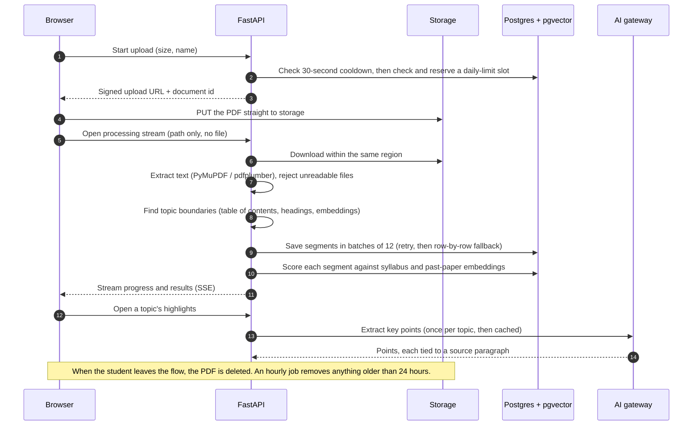
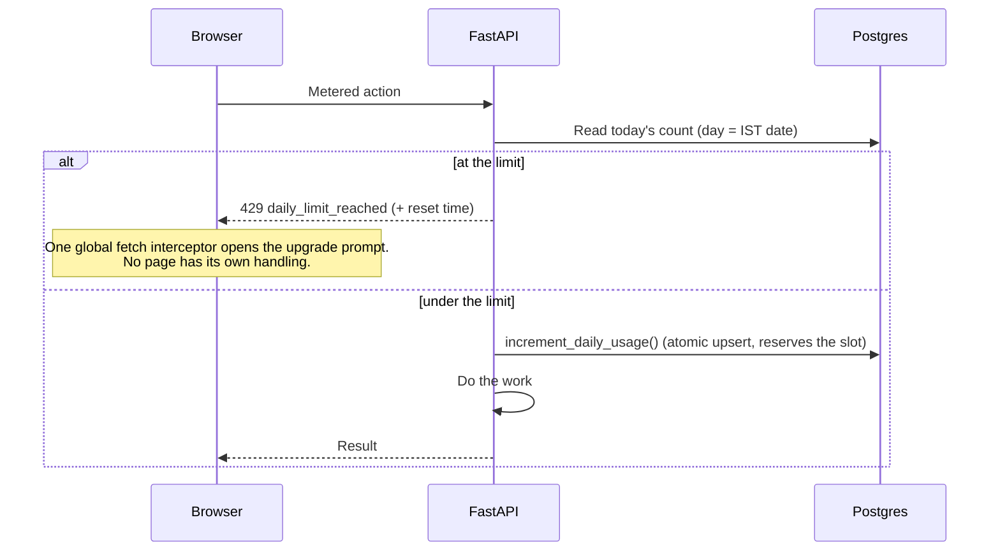
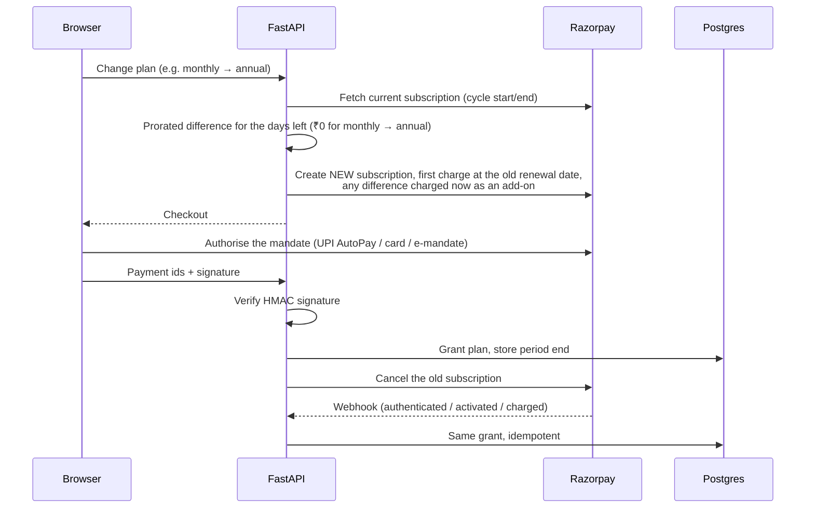
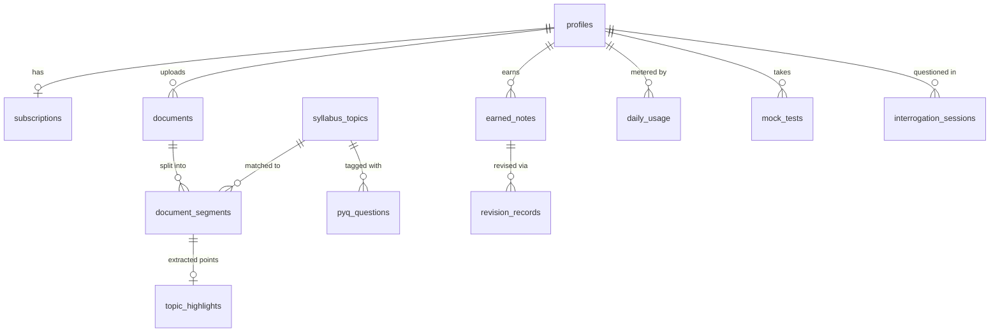

# Architecture

This page goes one level deeper than the [README](../README.md): how a request moves through the system, how an upload becomes study material, how daily limits and payments work, and what runs on a schedule.

## Deployment topology

| Piece | Where it runs | Why there |
|---|---|---|
| Next.js frontend | Vercel, served from the Mumbai edge | Users are in India; static pages and assets come from the nearest edge |
| FastAPI backend | Railway, Singapore | Same region as the database, so queries never cross a region |
| Postgres, Auth, Storage | Supabase, Singapore | Co-located with the API. It moved here from Mumbai to remove a cross-region hop on every query |
| Embedding model | Inside the API process, on CPU | 384-dim MiniLM is small enough for CPU, which avoids a separate inference service and a network hop per embedding |
| Background jobs | Inside the API process (APScheduler) | No Redis or Celery to operate; one process owns the schedule |

The only traffic that still has to cross from India to Singapore is a student's upload. That's why uploads skip the API server and go straight to storage (see below).

## A request, end to end

1. **CORS and rate limiting.** Allowed origins are fixed. Sign-in, upload, text analysis and highlight endpoints are rate-limited with slowapi, and the public forms (waitlist, legal requests) have their own per-client limits.
2. **Authentication.** The API verifies the Supabase JWT locally with the project's signing secret. Earlier it called Supabase Auth over the network on every request, which added a round trip to every page load. There's a network fallback for asymmetric-key tokens.
3. **Plan lookup.** The user's plan is cached for 10 seconds per user, and any write that changes a subscription clears that user's entry straight away.
4. **Daily limit (metered features only).** See [Daily limits](#daily-limits) below.
5. **Handler.** The Supabase Python client is synchronous, so blocking calls are moved off the async event loop into a thread pool. The pool was raised from 40 to 64 threads so one worker can keep more queries in flight.
6. **After the response.** Session activity is updated in a fire-and-forget task, so it never adds latency.

Long-running work (upload processing, highlight generation, mock-test evaluation) streams progress back over Server-Sent Events. Six endpoint modules stream this way.

## From upload to study material

Some decisions behind it:

- **The API never buffers the file.** Before this change, a single worker spent about a minute receiving each large PDF, and Railway's proxy timeout could kill the request and make the browser send it again. If the direct path fails, the client falls back to the old multipart upload automatically, so the change could never make things worse than before.
- **Saves are batched and checked.** Topics used to be written one at a time with failures silently dropped. That's how the same PDF could show 77, then 29, then 10 topics. Batches of 12 with retries cut about 77 round trips to about 7, and the summary is rebuilt from what was actually saved.
- **Uploads are always reprocessed.** There's no content-hash shortcut for repeat uploads, because the product deliberately doesn't keep PDFs around.

## Daily limits

Every feature is free. Six AI-heavy features are metered per user per day, and the free and paid plans differ only in the limit.

| Feature | Free per day | Paid per day |
|---|---|---|
| PDF / text uploads | 5 | 20 |
| Mock tests | 1 | 5 |
| Answer evaluations | 5 | 25 |
| Photo / handwriting uploads | 3 | 20 |
| AI questioning sessions | 10 | 40 |
| Study-material builds | 5 | 25 |

- **The slot is reserved before the expensive work starts.** That keeps the count honest even when a request dies halfway through an AI call. The cost is that a failed action still uses up the student's slot.
- **The increment is one Postgres function** (`INSERT ... ON CONFLICT DO UPDATE`), so concurrent requests are never miscounted. The check and the increment are separate calls, so two requests that arrive together at the limit can both get through. For a daily allowance, going over by one is an acceptable trade for not locking a row on every request.
- **There's no reset job.** The day is part of the key, so the count starts at zero when the IST date changes.
- **Reads fail open.** If the usage table can't be reached, the request goes through. A database hiccup shouldn't lock a paying user out.
- **Cost audit.** Every model call site was traced to either a daily limit or a computation done once per topic and cached (highlights, cross-paper links). The questioning feature is capped at three rounds per session.

## Subscriptions

One paid plan, billed monthly or yearly through Razorpay.

- **Why a new subscription instead of an update:** Razorpay's subscription update only works on cards, and most Indian users pay with UPI AutoPay. Creating a new subscription with a deferred start works on every payment method.
- **Two activation paths on purpose:** the signed call from the browser makes access instant, and the webhook covers the case where the browser closes before that call lands. Both are idempotent, and the welcome email is sent exactly once across the two.
- **Promo codes:** Razorpay offers apply to only one payment instrument, so a code is resolved to a percentage in Postgres and the discounted first cycle is charged as an add-on before the full-price plan starts. One promo per account, ever.
- **Cancellation:** stops renewal at the end of the paid period, and access continues until then. A resume creates a fresh subscription that starts when the old period ends, so nobody is charged twice.

## Scheduled jobs

All jobs run in IST with explicit timezones. Before that fix, the triggers silently fired on UTC.

| Job | Schedule (IST) | What it does |
|---|---|---|
| Daily recall | hourly | Recall prompts at each user's chosen reminder time |
| Streak reminder | 21:00 | Nudges users with an active streak who haven't studied today |
| Weekly summary | Sunday 09:00 | Progress email for users who opted in |
| Official sources | 06:00 | Pulls and embeds new articles from official publications |
| Expire subscriptions | 00:05 | Moves lapsed cancelled plans back to free |
| Expire bonus credits | 00:10 | Legacy cleanup from the old credit model |
| PDF cleanup | hourly at :15 | Deletes any upload still in storage after 24 hours |
| Memory maintenance | every 15 min | Returns freed heap to the OS and logs memory use |

- **Safe to re-run:** every job gives the same result run twice as run once.
- **Single owner:** if the server runs several worker processes, an exclusive file lock elects one to own the schedule. A per-replica flag disables scheduling on extra replicas.

## Data model (core tables)

50 tables in total. These are the ones the main study loop runs through.

A document is split into segments, and segments are the unit everything else attaches to: scores, extracted points, past-paper matches. One PDF can cover several syllabus topics, so attaching results to the whole document would mix them up.
